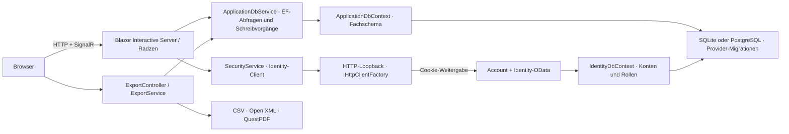
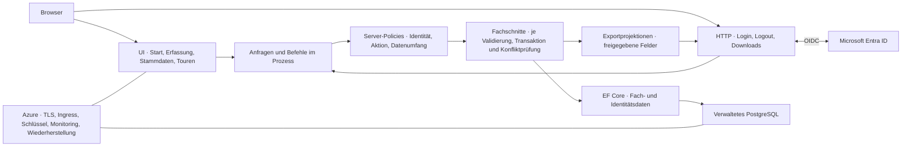
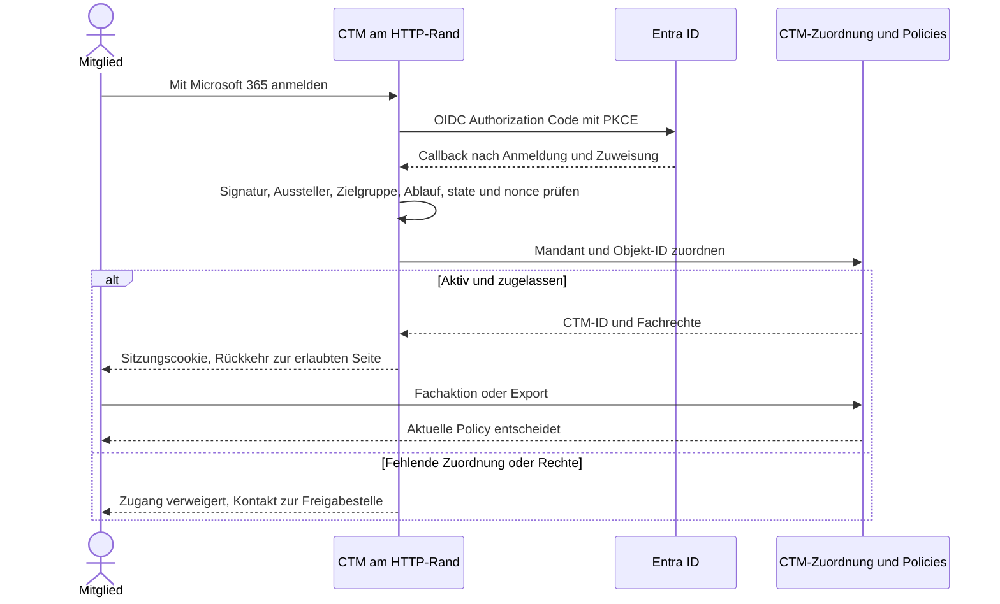

# CTM-Projektanalyse

Entscheidungsvorschlag zu Issue #2 · Stand 20.11.2026 · Basis `9c79e94489abcfd7d3f8a264cdf98d9f0f64740a`

**Empfehlung.** Die bestehende Anwendung in fachlich vollständigen Etappen mit .NET 10 und EF Core modernisieren. Zuerst Zugriffe absichern und den Bestand mit synthetischen Testfällen abbilden. Dann Microsoft-365-Anmeldung und Betrieb in einer isolierten Umgebung nachweisen. Für den Pilot ist eine warme Container-App mit verwaltetem PostgreSQL die Arbeitshypothese. UI, Rechte, Datenübernahme und Betrieb gehen mit den zugehörigen Kriterien als gemeinsamer Vorschlag zur Freigabe.

## AC1 · Funktionsumfang und Bedienung

Die Navigation liegt in [MainLayout.razor, Z. 21–57](../../src/ChristmasTreeManager/Components/Layout/MainLayout.razor#L21-L57). Die Tabelle beschreibt Bedienwege aus dem Quellcode am Basis-Commit. Technische Zugriffsgrenzen und Laufzeitnachweise folgen darunter.

| Bereich und Einstieg | Bedienung, Zustand und Ergebnis | Fundstellen |
| --- | --- | --- |
| **Start** | Summen für Bäume und Beträge, Verläufe nach Datum, Bäume nach Annahmestelle, Tourzählung und Straßen ohne Zuordnung. Die Grafik „Touren“ verwendet je Gruppe `RegistrationCount`, obwohl die Reihe „Bäume“ heißt. | [Index.razor, Z. 1, 37–65](../../src/ChristmasTreeManager/Components/Pages/Index.razor#L37-L65) |
| **Login und Profil** | Geschützte Seite führt zur Anmeldung. Mit bestätigtem lokalem Konto per E-Mail und Passwort anmelden. Falsche Daten und fehlende Bestätigung führen zu Fehlermeldungen. Login bietet Passwort-Reset und Kontoregistrierung. Profil ändert das eigene Passwort mit Altpasswort und Bestätigung. Abmelden beendet die lokale Sitzung. | [Routes.razor, Z. 1–9](../../src/ChristmasTreeManager/Components/Routes.razor#L1-L9), [Login.razor, Z. 10–17, 33–64](../../src/ChristmasTreeManager/Components/Pages/Login.razor#L10-L17), [AccountController.cs, Z. 52–137](../../src/ChristmasTreeManager/Controllers/AccountController.cs#L52-L137), [Profile.razor, Z. 18–58](../../src/ChristmasTreeManager/Components/Pages/Profile.razor#L18-L58) |
| **Benutzerkonto registrieren** | „Registrieren“ im Login öffnet den Dialog `RegisterApplicationUser` mit eigener Komponentenroute `/application-user/register`. Die lokale Kontoregistrierung verarbeitet E-Mail und Passwort im Account-Controller und sieht einen Bestätigungslink per E-Mail vor. Der UI-Dialog zeigt Validierungs- und Dienstfehler. Funktionierender Mailversand ist eine Voraussetzung für diesen normalen Anmeldeweg. | [Login.razor, Z. 45–52](../../src/ChristmasTreeManager/Components/Pages/Login.razor#L45-L52), [RegisterApplicationUser.razor, Z. 1, 14–28](../../src/ChristmasTreeManager/Components/Pages/RegisterApplicationUser.razor#L14-L28), [AccountController.cs, Z. 140–187](../../src/ChristmasTreeManager/Controllers/AccountController.cs#L140-L187) |
| **Profilmenü → Benutzer / Rollen** | Benutzer listen, anlegen, bearbeiten und nach Bestätigung löschen. Rollen zuweisen und Passwort setzen. Rollen listen, anlegen und nach Bestätigung löschen. Dialoge zeigen Eingabe- oder Dienstfehler. Rollenverwaltung ist im Menü für angemeldete Personen sichtbar. | [ApplicationUsers.razor, Z. 10–90](../../src/ChristmasTreeManager/Components/Pages/ApplicationUsers.razor#L10-L90), [EditApplicationUser.razor, Z. 27–57](../../src/ChristmasTreeManager/Components/Pages/EditApplicationUser.razor#L27-L57), [ApplicationRoles.razor, Z. 10–78](../../src/ChristmasTreeManager/Components/Pages/ApplicationRoles.razor#L10-L78) |
| **Anmeldungen → Neu** | Abholanmeldung erfasst Datum, Annahmestelle, Name, Straße, Hausnummer mit Zusatz, Baumanzahl und Betrag sowie optional Telefon, E-Mail und Kommentar. Annahmestelle und Straße müssen schon existieren. „Speichern“ schließt den Dialog und aktualisiert die Liste. „Speichern&Neu“ startet die nächste Erfassung mit übernommenem Datum und Annahmestelle. Pflichtfeldfehler bleiben im Formular, ein Speicherfehler erscheint als allgemeine Meldung. Liste filtern, sortieren und blättern. Zeile per Doppelklick bearbeiten, Löschen bestätigen. | [AddRegistration.razor, Z. 16–111, 143–201](../../src/ChristmasTreeManager/Components/Pages/AddRegistration.razor#L143-L201), [Registrations.razor, Z. 1, 11–56](../../src/ChristmasTreeManager/Components/Pages/Registrations.razor#L11-L56), [RegistrationEntity.cs, Z. 7–38](../../src/ChristmasTreeManager.Data/Application/RegistrationEntity.cs#L7-L38) |
| **Annahmestellen** | Name und Anschrift anlegen, per Doppelklick bearbeiten oder nach Bestätigung löschen. Die Stelle wird in Abholanmeldungen referenziert. Vor der späteren Überarbeitung Löschfolgen bei abhängigen Daten als Testfall festhalten. | [RegistrationPoints.razor, Z. 1, 15–42](../../src/ChristmasTreeManager/Components/Pages/RegistrationPoints.razor#L15-L42), [RegistrationPointEntity.cs, Z. 7–14](../../src/ChristmasTreeManager.Data/Application/RegistrationPointEntity.cs#L7-L14), [ApplicationDbService.cs, Z. 514–532](../../src/ChristmasTreeManager/Services/ApplicationDbService.cs#L514-L532) |
| **Straßen** | PLZ, Ort, Ortsteil und Name pflegen. Im Bearbeitungsdialog Hausnummernbereich, optionale Zettel- und Sammlungstour, Zettelzahl und Sammelreihenfolge setzen. Beide Touren müssen für eine Zuordnung vorhanden sein. Bestätigung und Fehlermeldung beim Löschen. | [Streets.razor, Z. 1, 15–56](../../src/ChristmasTreeManager/Components/Pages/Streets.razor#L15-L56), [EditStreet.razor, Quellzeile 1, Feldnamen](../../src/ChristmasTreeManager/Components/Pages/EditStreet.razor#L1), [StreetEntity.cs, Z. 8–30](../../src/ChristmasTreeManager.Data/Application/StreetEntity.cs#L8-L30) |
| **Zettelaustragen → Zetteltour → Straßen** | Tour anlegen, Name und Mitarbeiter bearbeiten, Löschen bestätigen. Straßen über die Straßenpflege zuordnen. Zeilenaktion mit Listensymbol öffnet Tourdetail mit Straßen und Zettelanzahl. Dort lässt sich eine Straße per Doppelklick bearbeiten. Das PDF zeigt Straßen und Zettelzahlen mit Summe. | [DistributionTours.razor, Z. 20–53, 69–110](../../src/ChristmasTreeManager/Components/Pages/DistributionTours.razor#L69-L110), [StreetsForDistributionTour.razor, Z. 57–75](../../src/ChristmasTreeManager/Components/Pages/StreetsForDistributionTour.razor#L57-L75), [ExportService.cs, Z. 172–233](../../src/ChristmasTreeManager/Services/ExportService.cs#L172-L233) |
| **Sammlung → Sammlungstour → Anmeldungen** | Tour anlegen, Name, Fahrzeug, Fahrer, Teamleitung und Mitarbeiter im Bearbeitungsdialog pflegen, Löschen bestätigen. Zeilenaktion zeigt Abholanmeldungen über die der Tour zugeordneten Straßen. Die Projektion ist nach Straßenreihenfolge, Straßenname und Hausnummer sortiert. Ausgabe für das Sammelteam enthält Adresse, Name, Anzahl und Arbeitsinformationen. | [CollectionTours.razor, Z. 1, 14–46](../../src/ChristmasTreeManager/Components/Pages/CollectionTours.razor#L14-L46), [EditCollectionTour.razor, Quellzeile 1, Felddefinitionen](../../src/ChristmasTreeManager/Components/Pages/EditCollectionTour.razor#L1), [RegistrationsForCollectionTour.razor, Z. 1, 10–41](../../src/ChristmasTreeManager/Components/Pages/RegistrationsForCollectionTour.razor#L10-L41), [ApplicationDbService.cs, Z. 82–98](../../src/ChristmasTreeManager/Services/ApplicationDbService.cs#L82-L98) |

„Einnahmen“ zeigt die Summe von `Donation`. „Spenden“ zeigt dieselbe Summe nach Abzug von drei Geldeinheiten je Baum, im Code `serviceCharge` und `profit`. Der Basisstand belegt die Rechnung. Fachlich offen bleiben die Höhe, die Bedeutung des Abzugs und die korrekten Bezeichnungen. Der Migrationsabgleich verwendet die gespeicherten Beträge. [Index.razor, Z. 1, 59–60](../../src/ChristmasTreeManager/Components/Pages/Index.razor#L59-L60)

### Exportmatrix

„Verbunden“ bedeutet, dass der Menüwert einen vorhandenen Controller- und Dateipfad erreicht. Die letzte Spalte erfasst je angebotenem Format die Laufzeitprüfung. Ein Strich steht für kein Menüangebot. Seiten ohne Exportmenü sind Start, Login/Profil, Benutzer, Rollen und die Erfassungsdialoge.

| Ansicht | CSV | Excel (.xlsx) | PDF | Laufzeit je Angebot | Fundstellen |
| --- | --- | --- | --- | --- | --- |
| Anmeldungen | Angeboten, verbunden | Angeboten, verbunden | – | CSV, XLSX NOT RUN | [Registrations.razor, Z. 1, 58–75](../../src/ChristmasTreeManager/Components/Pages/Registrations.razor#L58-L75), [ExportController.cs, Z. 87–99](../../src/ChristmasTreeManager/Controllers/ExportController.cs#L87-L99) |
| Annahmestellen | Angeboten, verbunden | Angeboten, verbunden | – | CSV, XLSX NOT RUN | [RegistrationPoints.razor, Z. 1, 44–67](../../src/ChristmasTreeManager/Components/Pages/RegistrationPoints.razor#L44-L67), [ExportController.cs, Z. 73–85](../../src/ChristmasTreeManager/Controllers/ExportController.cs#L73-L85) |
| Straßen | Angeboten, verbunden | Angeboten, verbunden | – | CSV, XLSX NOT RUN | [Streets.razor, Z. 1, 65–78](../../src/ChristmasTreeManager/Components/Pages/Streets.razor#L65-L78), [ExportController.cs, Z. 101–113](../../src/ChristmasTreeManager/Controllers/ExportController.cs#L101-L113) |
| Zetteltouren | Angeboten, verbunden | Angeboten, verbunden | – | CSV, XLSX NOT RUN | [DistributionTours.razor, Z. 20–23, 114–135](../../src/ChristmasTreeManager/Components/Pages/DistributionTours.razor#L114-L135), [ExportController.cs, Z. 52–64](../../src/ChristmasTreeManager/Controllers/ExportController.cs#L52-L64) |
| Zetteltourdetail | Angeboten, verbunden | Angeboten, ohne Aktion. Menü sendet `xlsx`, Handler prüft `xls`. | Angeboten, verbunden | CSV, XLSX, PDF NOT RUN | [StreetsForDistributionTour.razor, Z. 19–23, 78–106](../../src/ChristmasTreeManager/Components/Pages/StreetsForDistributionTour.razor#L78-L106), [ExportController.cs, Z. 66–71, 101–113](../../src/ChristmasTreeManager/Controllers/ExportController.cs#L66-L71) |
| Sammlungstouren | Angeboten, verbunden | Angeboten, verbunden | – | CSV, XLSX NOT RUN | [CollectionTours.razor, Z. 1, 50–63](../../src/ChristmasTreeManager/Components/Pages/CollectionTours.razor#L50-L63), [ExportController.cs, Z. 17–22, 38–43](../../src/ChristmasTreeManager/Controllers/ExportController.cs#L38-L43) |
| Sammlungstourdetail | Angeboten, verbunden | Angeboten, verbunden. Handler prüft `xlsx`. | Angeboten, verbunden | CSV, XLSX, PDF NOT RUN | [RegistrationsForCollectionTour.razor, Z. 1, 25–42](../../src/ChristmasTreeManager/Components/Pages/RegistrationsForCollectionTour.razor#L25-L42), [ExportController.cs, Z. 24–49](../../src/ChristmasTreeManager/Controllers/ExportController.cs#L24-L49) |

Die Übersichtslisten übernehmen Filter und Sortierung aus dem Grid. Das Zetteltourdetail übernimmt für CSV die Tourzuordnung und Sortierung. Das Sammlungstourdetail exportiert den Tourbestand unabhängig vom aktuellen Gridfilter. Der PDF-Pfad der Zetteltour lädt separat alle zugeordneten Straßen. CSV- und Excel-Ausgaben können andere Spalten als die sichtbare Tabelle enthalten, da sie aus den Exportprojektionen bzw. einfachen Eigenschaften der Modelle erzeugt werden. CSV verbindet Feldwerte per Komma ohne Maskierung. Kommas, Zeilenumbrüche und Anführungszeichen können daher die Feldgrenzen verändern. Vor Paritätsabnahme Inhalt, Reihenfolge, Spalten und Filterumfang pro Format prüfen. [RegistrationsForCollectionTour.razor, Z. 25–42](../../src/ChristmasTreeManager/Components/Pages/RegistrationsForCollectionTour.razor#L25-L42) · [ExportController.cs, Z. 66–71](../../src/ChristmasTreeManager/Controllers/ExportController.cs#L66-L71) · [ExportService.cs, Z. 239–379](../../src/ChristmasTreeManager/Services/ExportService.cs#L239-L379)

### Zugriffsgrenzen im Bestand

| Ebene | Feststellung aus dem Basisstand |
| --- | --- |
| Fachseiten und Navigation | `[Authorize]` verlangt auf geschützten Seiten eine Anmeldung. Die Attribute benennen keine Fachrollen. Das Profilmenü prüft auf Anmeldung, Fachservices haben keine Rollenprüfung. [Routes.razor, Z. 1–9](../../src/ChristmasTreeManager/Components/Routes.razor#L1-L9) · [MainLayout.razor, Z. 21–28](../../src/ChristmasTreeManager/Components/Layout/MainLayout.razor#L21-L28) · [ApplicationDbService.cs, Z. 113–163](../../src/ChristmasTreeManager/Services/ApplicationDbService.cs#L113-L163) |
| Konten und Rollen | Die anonyme Selbstregistrierung im Account-Controller ist vom registrierenden Dialog und von fachlichen Abholanmeldungen zu unterscheiden. Nach Bestätigung reicht ein gültiges lokales Konto für den geschützten Bereich. Die Identity-OData-Controller prüfen auf beliebige Anmeldung. Benutzer und Rollen anlegen oder löschen, Rollen zuweisen sowie Passwörter setzen sind darüber fachlich unbeschränkt. [AccountController.cs, Z. 79–94, 140–187](../../src/ChristmasTreeManager/Controllers/AccountController.cs#L140-L187) · [ApplicationUsersController.cs, Z. 12–152](../../src/ChristmasTreeManager/Controllers/ApplicationUsersController.cs#L12-L152) · [ApplicationRolesController.cs, Z. 10–81](../../src/ChristmasTreeManager/Controllers/ApplicationRolesController.cs#L10-L81) |
| Exporte | Der Exportcontroller hat keine serverseitige Authentifizierungsanforderung. Der vorhandene Autorisierungsfilter wird nicht registriert. Exportdaten und dynamische Filter bilden daher bei einer erreichbaren Bereitstellung eine Zugriffslücke. [ExportController.cs, Z. 6–113](../../src/ChristmasTreeManager/Controllers/ExportController.cs#L6-L113) · [Program.cs, Z. 33, 127–141](../../src/ChristmasTreeManager/Program.cs#L127-L141) · [ApplicationAuthorizeFilter.cs, Z. 7–21](../../src/ChristmasTreeManager/Filters/ApplicationAuthorizeFilter.cs#L7-L21) |
| Technik ohne Bedienzuordnung | Der Reportcontroller enthält einen ungeschützten Weiterleitungsproxy mit Weitergabe sensibler Header und serverseitigem Anmeldekontext. Der Uploadcontroller enthält einen ungeschützten Bilder-Upload mit Speicherung im Webroot und drei Platzhalter. Beide haben keinen belegten Einstieg in der Navigation. [ReportController.cs, Z. 8–122](../../src/ChristmasTreeManager/Controllers/ReportController.cs#L8-L122) · [UploadController.cs, Z. 14–82](../../src/ChristmasTreeManager/Controllers/UploadController.cs#L14-L82) |

### Reproduzierbarer lokaler Durchlauf

Für die Laufzeitprüfung ein frisches Browserprofil verwenden. ASP.NET Core in `Development` nur am Loopback starten und `ConnectionStrings__Application=Data Source=<absoluter Scratch-Pfad>/ctm-synthetisch.db` für beide Kontexte sowie SQLite als Provider einstellen. Die Entwicklungsdatei im Repository verwendet einen relativen Windows-Pfad. Applikations- und Kontodaten sowie ggf. die Schlüsselablage bleiben temporär. Für den Login den lokalen Entwicklungsweg oder ein eigens angelegtes synthetisches Konto verwenden. Den im Bestand hinterlegten Altzugang und die konfigurierte externe Umgebung dabei ausschließen. [appsettings.Development.json, Z. 2–4](../../src/ChristmasTreeManager/appsettings.Development.json#L2-L4) · [Program.cs, Z. 42–86, 163–173](../../src/ChristmasTreeManager/Program.cs#L163-L173) · [AccountController.cs, Z. 52–94](../../src/ChristmasTreeManager/Controllers/AccountController.cs#L52-L94)

1. **Anmelden.** Im frischen Browser „Start“ öffnen, Umleitung zur Anmeldemaske prüfen, einmal ungültige Eingabe und dann gültige synthetische Anmeldung auslösen. Erwartet sind eine verständliche Fehlermeldung und danach die Startübersicht. Profil öffnen und „Abmelden“ am Ende prüfen.
2. **Abholanmeldung speichern.** „Annahmestellen“ → „Add“ → „Teststelle Nord“ und „Straßen“ → „Add“ → „Testweg“ anlegen. „Anmeldungen“ → „Neu“ wählen. Fehlenden Namen einmal absenden, dann „Testperson A“, Testweg 7a, zwei Bäume und 12,50 € erfassen. Mit „Speichern&Neu“ speichern, Datum und Stelle im neuen Formular prüfen und abbrechen. In der Liste nach Testperson filtern und die gespeicherte Zeile per Doppelklick öffnen. Bei Abbruch des Folgeformulars die Ansicht neu laden. Der Handler kann vor dem Grid-Reload zurückkehren.
3. **Tour exportieren.** „Zettelaustragen“ → „Add“ → „Testtour Z“, danach unter „Straßen“ Testweg bearbeiten, Tour und drei Zettel setzen. Über das Listen-Symbol in die Tour wechseln und PDF exportieren. PDF öffnen und Testweg, Zettelzahl und Summe prüfen. Für die CSV dieselbe Zeile abgleichen. Excel-Menüeintrag separat beobachten. Für die Sammelvariante dieselbe Straße einer Sammlungstour zuordnen, das Anmeldungsdetail öffnen und XLSX mit Testperson und zwei Bäumen prüfen.

Der Abschnitt „Verifikation“ dokumentiert den Laufzeitstatus. Dateiintegrität und Downloads sind anhand der Schritte separat prüfbar.

## AC2 · Bedienkonzept und Stil

### Visuelle Referenz

Sichtung am 20.11.2026 durch den Implementer. Auf der offiziellen Startseite gruppieren kurze Überschriften, Einsatzkennzahlen, Piktogramme und ein Fotobereich die Inhalte. Der indexierte Original-Schriftzug der Feuerwehr verbindet ein rotes Motiv und gelbe Konturen mit einem dunklen Grund und einer kräftigen, schmalen serifenlosen Wortmarke. Vollständig gerenderter Webseitenvergleich **NOT RUN**. Der direkte Abruf in der Arbeitsumgebung war gesperrt, der Webabruf lieferte die Seitenstruktur und den Bildsuchnachweis, der Abruf der Originaldatei schlug fehl. [Offizielle Startseite](https://www.feuerwehr-traunstein.de/) · [Offizielle Seite „Über uns“](https://www.feuerwehr-traunstein.de/uber-uns/) · [Bildquelle der Feuerwehr](https://www.feuerwehr-traunstein.de/media/FF-Traunstein_Logo_Text-rechts.png)

| CTM-Datei · tatsächlich als Bild gesichtet | Beobachtung |
| --- | --- |
| [pdf-background.png](../../src/ChristmasTreeManager/wwwroot/images/pdf-background.png) | CTM-Briefbogen und visuelle Ersatzreferenz für den nicht gerenderten Webauftritt. Weißraum, groß gesetzter roter Aktionstitel, horizontale rote Linien, oben rechts dunkles Wappen mit Rot und Gelb. Die Feuerwehridentität erscheint im Ausdruck. |
| [login.jpg](../../src/ChristmasTreeManager/wwwroot/images/login.jpg) | Helle diagonale Textur hinter der Anmeldung. |
| [logo.png](../../src/ChristmasTreeManager/wwwroot/images/logo.png) und [logo-login.png](../../src/ChristmasTreeManager/wwwroot/images/logo-login.png) | Bunter Pixelbaum, im Login mit weißer Wortmarke. Das Hauptlayout kombiniert ihn mit dem Radzen-Standardtheme in Hell und Dunkel. [LoginLayout.razor, Z. 16–24](../../src/ChristmasTreeManager/Components/Layout/LoginLayout.razor#L16-L24) · [MainLayout.razor, Z. 21, 45–56](../../src/ChristmasTreeManager/Components/Layout/MainLayout.razor#L21-L56) |

| Heute im Arbeitsablauf | Vorschlag für die Überarbeitung |
| --- | --- |
| Einstieg mit zwei englischen Vorlagenresten („Fetching data from GitHub...“, „Your Success Is Our Biggest Priority“). Die Fehlerkarte liegt in der Lade-/Erfolgskarte und erscheint damit bei einem Fehler nicht eigenständig. [Index.razor, Quellzeile 1, Lade- und Fehlerkarten](../../src/ChristmasTreeManager/Components/Pages/Index.razor#L1) | Start zeigt direkt Aufgaben und aussagekräftig benannte Kennzahlen. Leerzustand mit nächstem Schritt, Laden mit Text, Fehler mit Wiederholen. |
| Erfassung zeigt englische Pflichtfeldtexte und einen allgemeinen Speicherfehler ohne Feldgrund. Die Erfolgsmeldung läuft nach 1,5 s ab. [AddRegistration.razor, Z. 16–81, 184–196](../../src/ChristmasTreeManager/Components/Pages/AddRegistration.razor#L16-L81) | Deutsche Fehler am Feld, Werte beim Korrigieren behalten. „Speichern&Neu“ führt Datum und Stelle weiter. Bestätigung im Formular und in der aktualisierten Liste. |
| Die Anmeldungsliste hat 15 Spalten inklusive Aktionen mit festgelegten Breiten. Bearbeiten erfordert Doppelklick. Löschen fragt nach, bietet keinen Rückgängig-Schritt. [Registrations.razor, Quellzeile 1, Grid](../../src/ChristmasTreeManager/Components/Pages/Registrations.razor#L1) · [Registrations.razor, Z. 40–56](../../src/ChristmasTreeManager/Components/Pages/Registrations.razor#L40-L56) | Desktop-Tabelle mit sichtbarer Zeilenaktion „Bearbeiten“. Mobil Karte mit Name/Adresse und Anzahl, weitere Angaben im Detail. Löschdialog mit Objektname und Folgen, Rückgängig nur nach Freigabe der Löschregel. |
| Touren „Add“ neben „Neu“ bei Anmeldungen, Listensymbol für Straßen ohne Beschriftung und falscher Tourtyp im Löschfehler der Zetteltour. Filterwirkung und Formate variieren. [DistributionTours.razor, Z. 20–34, 94–110](../../src/ChristmasTreeManager/Components/Pages/DistributionTours.razor#L20-L34) · [Registrations.razor, Quellzeile 1](../../src/ChristmasTreeManager/Components/Pages/Registrations.razor#L1) | „Neue Tour“, „Straßen öffnen“ und „Abholungen öffnen“. Export nennt Format, Umfang und Zahl der Einträge vor dem Download. Erzeugung, Ergebnis und Fehler mit Wiederholen haben sichtbare Zustände. |

### Bildschirmkonzept

Der vorgeschlagene Wechsel ist von Textur, Pixelbaum und Standardkomponenten zu ruhigen Flächen, einer roten Aktionsfarbe, einer klaren Kopfzeile und Gelb als sparsamer Markierung auf dunkler Fläche. Serifenlose Systemschrift, z. B. `system-ui, "Segoe UI", sans-serif`, 16 px für Fließtext, 24–32 px für Seitentitel, tabellarische Ziffern für Summen. Die Kartenstruktur der offiziellen Seite wird für Aufgaben und Tourstatus aufgegriffen. Nutzungsrechte für Wappen, Foto und bestehende CTM-Markenbestandteile vor Umsetzung klären.

Die ASCII-Skizzen zeigen Zielzustände mit synthetischen Werten. Annahme zur Prüfung durch den Designer und Eigentümer: Desktop für Annahmestelle und Tourplanung, Mobil für ein Gerät im Feld und gelegentliche Erfassung. Listen und Schreibaktionen werden nur gemäß zugewiesenen Rechten angeboten. Fehlermeldungen und Bestätigungen sind alternative Zustände.

**Login · Mobil 360 × 800 CSS px · Einsatzteam**

```text
┌─────────────────────────────────┐
│ [Wappenplatz] Aktion Christbaum  │
│─────────────────────────────────│
│ Anmelden                        │
│ [ Mit Microsoft 365 anmelden ] │
│ ! Konto ohne Freigabe.          │
│   Freigabe bei Leitung klären.  │
│ [ Zugangshilfe ]                │
├─ Nach Anmeldung ────────────────┤
│ ✓ Angemeldet.                   │
│ Meine Touren                    │
│ Testtour A       [Bearbeiten]   │
│ ✓ Tour gespeichert.             │
└─────────────────────────────────┘
```

**Login · Desktop 1280 × 800 CSS px · Annahmestelle**

```text
┌──────────────────────────────────────────────────────────┐
│ [Wappenplatz] Aktion Christbaum            [Zugangshilfe] │
├─────────────────────────────┬────────────────────────────┤
│ [Optionaler Fotoplatz]      │ Anmelden                   │
│                             │ [Mit Microsoft 365 anmelden]│
│                             │ ! Organisationskonto wählen│
├─ Nach Anmeldung ────────────┴────────────────────────────┤
│ ✓ Angemeldet.  Zuletzt bearbeitet                        │
│ Testperson A · Testweg 7a                  [Bearbeiten]   │
│ ✓ Anmeldung gespeichert.                                 │
└──────────────────────────────────────────────────────────┘
```

Beim OIDC-Login liegt das Kontofeld beim Anbieter. CTM zeigt den Fehler zum gewählten Konto beim Login-Einstieg und bietet Zugangshilfe an. Die Bestätigung und bearbeitbare Liste erscheinen erst auf der geschützten Folgeseite.

**Abholanmeldung · Mobil 360 × 800 CSS px · Nachtrag vor Ort**

```text
┌────────────────────────────────┐
│ [Menü] Neue Abholanmeldung     │
│ Datum [18.01.] Stelle [Nord ▼] │
│ Name [____________________]    │
│ ! Namen eingeben.             │
│ Straße [Testweg ▼] Nr. [7a]    │
│ Bäume [2] Betrag [12,50 €]     │
│ [Kontakt und Kommentar öffnen] │
│ [Speichern] [Speichern & Neu]  │
│ ✓ Anmeldung gespeichert.       │
│ Letzte im Vorgang              │
│ Testperson A     [Bearbeiten]  │
└────────────────────────────────┘
```

**Abholanmeldung · Desktop 1280 × 800 CSS px · Serienerfassung**

```text
┌─────────────────────────────────────────────────────────────┐
│ Start / Anmeldungen / Neu                                   │
├─────────────────────────────────┬───────────────────────────┤
│ Datum [18.01.] Stelle [Nord ▼]  │ Heute an Stelle Nord      │
│ Name [Testperson A]             │ Name        Bäume  Aktion │
│ Straße [Testweg ▼] Nr. [___]    │ Testperson B  1 [Bearbeiten]│
│ ! Hausnummer eingeben.         │                           │
│ Bäume [2] Betrag [12,50 €]      │ ✓ Anmeldung gespeichert.  │
│ [Telefon] [E-Mail] [Kommentar]  │                           │
│ [Speichern] [Speichern & Neu]   │                           │
└─────────────────────────────────┴───────────────────────────┘
```

**Touren · Mobil 360 × 800 CSS px · Teamleitung unterwegs**

```text
┌────────────────────────────────┐
│ [Menü] Touren                  │
│ [Sammlung] [Zettelverteilung]  │
│ [Tour suchen] [Neue Tour]      │
│ Testtour A · 8 Abholungen      │
│ [Abholungen öffnen]            │
│ [Bearbeiten] [Export wählen]   │
│ Bearbeiten: Name [________]    │
│ ! Tourname erforderlich.      │
│ [Speichern] [Abbrechen]        │
│ ✓ Tour gespeichert.            │
└────────────────────────────────┘
```

**Touren · Desktop 1280 × 800 CSS px · Tourplanung und Ausgabe**

```text
┌──────────────────────────────────────────────────────────────┐
│ Touren  [Zettelverteilung] [Sammlung]  [Suche]    [Neue Tour]  │
├───────────────────────────────────┬──────────────────────────┤
│ Name       Straßen  Aktion        │ Testtour Z bearbeiten    │
│ Testtour Z  2   [Straßen öffnen]   │ Name [______________]    │
│                [Bearbeiten]       │ ! Tourname erforderlich. │
│                [Export wählen]    │ Team [______________]    │
│ Umfang: 2 Straßen · [CSV] [PDF]    │ [Speichern] [Abbrechen]   │
│                                   │ ✓ Tour gespeichert.       │
└───────────────────────────────────┴──────────────────────────┘
```

### Prüfliste für den Designer · WCAG 2.2 AA

Vorschlagsfarben, berechnet mit sRGB-Linearisierung und `(Lhell + 0,05) / (Ldunkel + 0,05)`, auf zwei Stellen gerundet. Die zweite Zahl je Zelle gilt für die alternative Fläche. Beschriftungen und Symbole ergänzen die Farbsemantik. Die Messwerte beziehen sich auf die definierten Farben. Prüfung der später gerenderten Komponenten bleibt Teil der Abnahme. [W3C WCAG 2.2](https://www.w3.org/TR/WCAG22/)

| Paar | Hell · Fläche #FFFFFF / #F5F6F8 | Dunkel · Fläche #181C22 / #242A33 |
| --- | --- | --- |
| Haupttext | #1C2229 · 16,03 / 14,82 | #F7F8FA · 16,09 / 13,59 |
| Hinweistext | #4D5965 · 7,16 / 6,62 | #B9C5D0 · 9,74 / 8,23 |
| Primäraktion, Schrift / Füllung | #FFFFFF / #A51D25 · 7,49 | #1C2229 / #FF9A98 · 7,88 |
| Primärfüllung und Fehlertext auf Fläche | #A51D25 · 7,49 / 6,93 | #FF9A98 · 8,41 / 7,10 |
| Feldrahmen | #596673 · 5,88 / 5,44 | #8294A6 · 5,48 / 4,63 |
| Fokus | #005FCC · 5,98 / 5,53 | #FFCF33 · 11,58 / 9,78 |
| Erfolgstext | #14623C · 7,39 / 6,83 | #96E4BA · 11,48 / 9,70 |

Für das gelbe Referenzmotiv repräsentiert `#FFCF33` den vorgeschlagenen Gelbton. Auf Weiß erreicht er 1,48:1. In Hell eignet er sich als dekoratives Zeichen neben separat lesbarem Text. In Dunkel kann er den Fokus auf den geprüften Flächen markieren. Für den Fokusring um farbige Buttons einen sichtbaren Abstand bzw. einen zweifarbigen Ring vorsehen.

- [ ] **1.4.3 und 1.4.11 Kontrast:** Normaltext mindestens 4,5:1, Großtext 3:1, funktionale Umrisse und Zustände 3:1. In beiden Themes auch Hover, Fehler, Auswahl, Platzhalter und Fokus neben farbigen Schaltflächen nachmessen.
- [ ] **2.4.7 und 2.4.11 Fokus:** sichtbarer 2-px-Ring mit Abstand, logische Tab-Reihenfolge, Rückkehr zur auslösenden Aktion nach Dialogschluss. Klebende Kopfzeile, Tastatur und Meldungen dürfen das fokussierte Element nicht verdecken.
- [ ] **2.5.8 Zielgröße:** mindestens 24 × 24 CSS px, mobil 44 × 44 als Designziel. Maße von Symbolbuttons in den bisherigen 70-px-Spalten und vom Pager am gerenderten Element prüfen. Die Spaltenbreite allein sagt nichts über die Klickfläche.
- [ ] **2.1.1 Tastatur:** „Bearbeiten“, Filter, Dropdown und Export mit Tab/Shift-Tab, Enter bzw. Leertaste bedienen. Doppelklick als Zusatzweg zulassen. Dialog per Escape schließen, Fokus und Eingabestand sinnvoll wiederherstellen.
- [ ] **3.3.1 und 3.3.3 Fehler:** Text am Feld und verknüpfter Hinweis mit Korrekturvorschlag. Beim Absenden Fehlerzusammenfassung oder Fokus zum ersten Fehler, bereits erfasste Werte behalten.
- [ ] **3.3.7 Redundante Eingabe:** Datum und Annahmestelle bei „Speichern & Neu“ vorfüllen und korrigierbar halten.
- [ ] **3.3.8 Barrierefreie Authentifizierung:** Einfügen und Passwortmanager für einen freigegebenen lokalen Übergangsweg zulassen. OIDC-Rückkehr, MFA und Zugangshilfe mit Organisationskonten und assistiver Technik prüfen.
- [ ] **4.1.3 Statusmeldungen:** Bestätigung per Live-Region bzw. `role="status"`, verständliche Fehlermeldung und sichtbares Ergebnis bis zur nächsten Aktion. Beim Export auch Fortschritt und Abbruch mitteilen.
- [ ] Bei 320 CSS px / 400 % Zoom Kernaktionen und Text prüfen (1.4.10). Tabellen auf erforderliche Spalten begrenzen oder mit beschriftetem Scrollbereich und einem mobilen Kartenpfad versehen.

## AC3 · Architektur und Verbesserungen

### Ist-Grenzen



Blazor verwendet interaktive Server-Circuits. Fachseiten rufen den Anwendungsdienst direkt auf. Bei Identity und Kontenverwaltung baut der gleichnamige HTTP-Client seine Adresse aus dem Request-Host und dem Schema. Forwarded Headers berücksichtigen `X-Forwarded-Host`. Außerhalb von Development liest der Client `X-Forwarded-Proto` mit HTTPS als Ersatzwert. Cookies werden per Header Propagation weitergegeben. Im Quelltext steht deren Middleware nach `MapControllers`. Der aktuelle Request-Kontext ist für interaktive Blazor-Aufrufe nach dem initialen Request keine verlässliche Identitätsquelle. [App.razor, Z. 10–17](../../src/ChristmasTreeManager/Components/App.razor#L10-L17) · [Program.cs, Z. 19–33, 94–126, 144–161](../../src/ChristmasTreeManager/Program.cs#L94-L126) · [SecurityService.cs, Z. 19–25, 86–93](../../src/ChristmasTreeManager/Services/SecurityService.cs#L19-L25) · [Microsoft: HttpContext in Blazor](https://learn.microsoft.com/en-us/aspnet/core/blazor/components/httpcontext?view=aspnetcore-10.0)

### Zielbild und ADR-Entwurf



Vorgeschlagen ist ein modularer Monolith mit aktuellem Patchstand von .NET 10 und EF Core, PostgreSQL als Zielprovider. Fachschnitte für Erfassung, Stammdaten, Touren, Ausgaben und Identität. Der Server prüft die Policy an Dienstoperationen und HTTP-Grenzen. Pro Schreibbefehl ein kurzlebiger DbContext und eine Transaktion. Downloads verwenden explizite Projektionen je Zweck und dieselben Datenregeln wie der Fachschnitt. OIDC und Session-Cookie bleiben am HTTP-Rand. Nach Abbau des Identity-Loopbacks beziehen Circuit und HTTP-Einstiege Identität aus den jeweiligen authentifizierten Principals und prüfen dieselben serverseitigen Rechte. Dies ist eine Voraussetzung für den OIDC-Pilot. Radzen behalten, wenn Tastatur, Fokus und responsive Kernabläufe im Nachweis bestehen. Version und Exportbibliotheken getrennt vom Fachumbau prüfen. [Projektdatei, Z. 1–24](../../src/ChristmasTreeManager/ChristmasTreeManager.csproj#L1-L24) · [EF Core: Nebenläufigkeit](https://learn.microsoft.com/en-us/ef/core/saving/concurrency)

| Weg | Aufwand und Risiko | Rückfall |
| --- | --- | --- |
| **Inkrementelle Erneuerung im Bestand** | Mittlerer Aufwand. Pro Fachschnitt Altverhalten in synthetische Tests übersetzen, dienstseitig absichern und Komponenten austauschen. Übergangsaufwand für parallele UI-Einstiege und kompatible Schemaänderungen. Geringeres Risiko für unbemerkte Abweichungen bei Zuordnungen und Exporten. | Versionierter Build und kompatibles Schema pro Etappe. Umschaltung oder neues Release erst nach Vergleich. Bei inkompatiblen Schreibvorgängen den Rückweg aus AC6 einsetzen. |
| **Separater Neuaufbau auf derselben Plattform** | Höherer anfänglicher Aufwand und zwei Betriebs-/Abnahmepfade. Klare Grenzen ab Tag eins, aber Fachregeln, Berichte, Sortierungen und Sonderfälle müssen vollständig neu erfasst werden. Höheres Risiko für versteckte Paritätslücken. | Pilot mit isolierter Datenkopie und klarer Schreibhoheit. Altanwendung bleibt bis zur Abnahme maßgeblich. Nach Übernahme der Schreibhoheit gilt ebenfalls AC6. |

Den ersten Weg wählen, solange sich Zugriffsprüfung, DbContext-Lebensdauer und Exportverträge je Fachschnitt isoliert ändern lassen. Separaten Aufbau erneut bewerten, wenn sich diese Grenzen im technischen Nachweis nicht mit kompatiblen Änderungen herstellen lassen.

### Priorisierte Maßnahmen

| Rang | Ist-Beleg und Maßnahme | Messbares Ergebnis der Folgearbeit |
| --- | --- | --- |
| **P0 · Zugriff und Datenschutz** | Exportzugriff und frei formulierte Filter, zu breite Identity-Verwaltung und Selbstregistrierung, Altzugänge sowie Report-/Upload-Flächen aus AC1 und AC4. Serverseitige Policies etablieren, Eingaben für Filter/Sortierung typisieren und begrenzen, technische Altflächen ohne Geschäftszweck entfernen. | Anonym und falsche Fachrolle scheitern an jedem geschützten Einstieg einschließlich Downloads und Verwaltung. Positivtests pro Rolle. Kein produktiver Test im Analyseauftrag. |
| **P0 · Vertrauliche Betriebsdaten** | Verbindungszeichenfolgen werden ausgegeben. Exportmodelle enthalten potenziell Kontakt- und Adressdaten. Metadaten für Audit und Telemetrie mit minimiertem Feldsatz, Zweckbindung, Zugriff und bewilligter Aufbewahrung. Keine Zugangsdaten oder Inhalte aus Kontaktfeldern im Betriebslog. Downloads ohne öffentlichen Cache, begrenzte Freigabe und Schutz vor Tabellenformeln in CSV. | Synthetische Marker für Kontakt und Secret fehlen in Logs. Exporttest für erlaubte Spalten, CSV-Feldgrenzen und sicher dargestellte Zellinhalte. [Program.cs, Z. 42–86](../../src/ChristmasTreeManager/Program.cs#L42-L86) · [ExportService.cs, Z. 242–265](../../src/ChristmasTreeManager/Services/ExportService.cs#L242-L265) |
| **P1 · Validierung und Änderungskonflikte** | UI-Pflichtfelder allein reichen für Diensteingaben nicht aus. Registrierung wird ohne Concurrency-Token neu geladen und überschrieben. Versionsfeld, serverseitige Feld- und Beziehungsvalidierung, Status für veraltete Bearbeitung und Schutz vor doppeltem Absenden vorschlagen. | Zwei parallele Bearbeitungen ergeben einen erklärten Konflikt, keine still verlorene Änderung. Feldfehler sind reproduzierbar und vorhandene Eingaben bleiben beim Retry erhalten. [ApplicationDbService.cs, Z. 113–163](../../src/ChristmasTreeManager/Services/ApplicationDbService.cs#L113-L163) |
| **P1 · Reproduzierbare Abhängigkeiten** | Radzen-Wildcard, keine eingecheckte Lockdatei, ungenutztes DocX und aufzulösender Status der dynamischen Filterbibliothek. Festen SDK-/Paketstand, Lockdatei, transitive Inventarliste, Sicherheitsprüfung und Lizenznachweise für Release festlegen. | Gleiches Paketset aus sauberem Checkout. Nachweis im Releaseprozess, DocX nach Paritätscheck entfernt. [Projektdatei, Z. 11–24](../../src/ChristmasTreeManager/ChristmasTreeManager.csproj#L11-L24) |
| **P1 · Wiederherstellung** | Startmigration fängt Fehler ab, der dokumentierte Betrieb stützt sich auf Datei und Volume. Migration separat ausführen und protokollieren. Sicherung und Wiederherstellung mit Zeitmessung regelmäßig erproben. | Ziel aus definierter Sicherung wiederherstellen, Daten vergleichen, RPO/RTO dokumentieren. [Program.cs, Z. 163–173](../../src/ChristmasTreeManager/Program.cs#L163-L173) · [Compose, Z. 1–28](../../hosting/docker-compose.yml) |
| **P2 · Bedienung und Fachparität** | Erfassungsfluss, kleine Bildschirme, inkonsistente Exportsemantik und Zetteltour-Excel aus AC1/AC2 überarbeiten. | Je Format erwartete Werte, Reihenfolge und Umfang stimmen mit freigegebenem Vertrag überein. Abnahme der sechs Bildschirmzustände per Tastatur und Touch. |

### Abhängigkeiten im ADR · Erhebung 20.11.2026

| Paket/Kandidat | Zweck, Lizenz, Wartung und Sicherheitsprüfung |
| --- | --- |
| .NET 10, EF Core und Npgsql | Bestand, Weblaufzeit und Fachpersistenz. Aktuelle unterstützte Patchstände als Ziel. EF und .NET MIT, Npgsql PostgreSQL-Lizenz. Paketstände und Laufzeit-Patches vor Pilot in fixer Auflösung prüfen. [Microsoft .NET-Support](https://dotnet.microsoft.com/en-us/platform/support/policy/dotnet-core) · [EF Core](https://github.com/dotnet/efcore) · [Npgsql](https://github.com/npgsql/npgsql) |
| Radzen.Blazor, Open XML | Bestand, UI und XLSX. MIT gemäß Paketmetadaten. Lokaler Restore löste Radzen 13.2.1 und Open XML 3.3.0 auf. Grid-Verhalten und XLSX-Kompatibilität mit fixen Versionen prüfen. [Radzen-Paket](https://www.nuget.org/packages/Radzen.Blazor) · [Open XML-Paket](https://www.nuget.org/packages/DocumentFormat.OpenXml/3.3.0) |
| QuestPDF 2025.7.4, DocX 5.0.0 | QuestPDF erzeugt Tour-PDFs und ist auf Community eingestellt. Das installierte Paket enthält eine Community-MIT-Auswahl mit Nutzungsbedingungen. Der aktuelle Leitfaden führt geänderte Bedingungen. Betreiberstatus und Anwendbarkeit der konkreten Paketlizenz vor Weiternutzung klären. DocX ist als Paket referenziert, ohne belegte Quellcodeverwendung. Seine beiliegende Xceed Community License beschränkt die Nutzung, u. a. auf nichtkommerziellen Einsatz und einen kleinen Nutzerkreis. Entfernung nach Paritätsnachweis vorschlagen. [QuestPDF-Paket](https://www.nuget.org/packages/QuestPDF/2025.7.4) · [QuestPDF-Lizenzleitfaden](https://www.questpdf.com/license/guide.html) · [DocX-Paket](https://www.nuget.org/packages/DocX/5.0.0) |
| Dynamic LINQ im Radzen-Pfad | Der Quellcode verwendet den Namespace `System.Linq.Dynamic.Core`. In der lokalen Auflösung fehlt eine separate Paket-ID dieses Namens. Der Namespace ist im Radzen-Assembly enthalten. Die eingebettete Implementierung hatte im Paketaudit keinen eigenen Eintrag. Version, Herkunft und anwendbare Advisories sind vor der Freigabe zu ermitteln. Vorschlag bleibt der Ersatz freier Ausdrücke durch begrenzte Filter. [ApplicationDbService.cs, Z. 6, 17–42](../../src/ChristmasTreeManager/Services/ApplicationDbService.cs#L17-L42) · [Radzen-Quellprojekt](https://github.com/radzenhq/radzen-blazor) |
| Microsoft.Identity.Web | Kandidat für Anmeldung und Tokengültigkeitsprüfung über die ASP.NET-Core-OIDC-Middleware, MIT, von Microsoft gepflegt. Als kleinere Alternative reicht die integrierte OIDC-Middleware, sofern Zuordnung und Abmeldung damit vollständig nachgewiesen werden. [Microsoft Identity Web](https://github.com/AzureAD/microsoft-identity-web) |
| Azure.Extensions.AspNetCore.DataProtection.Blobs und .Keys | Kandidaten für persistente Schlüssel in Blob Storage und Verschlüsselung des Schlüsselrings via Key Vault, MIT, im Azure SDK für .NET gepflegt. Nur einsetzen, wenn die gewählte Betriebsvariante den gemeinsamen Ring erfordert. [Microsoft: Data-Protection-Konfiguration](https://learn.microsoft.com/en-us/aspnet/core/security/data-protection/configuration/overview?view=aspnetcore-10.0) · [Azure SDK für .NET](https://github.com/Azure/azure-sdk-for-net) |
| Microsoft.Playwright und Testcontainers.PostgreSql | Kandidaten nur für Tests. Browserabläufe und reale PostgreSQL-Semantik automatisieren. Apache-2.0 bzw. MIT, aktive Upstream-Projekte. Gegen einen bereitgestellten isolierten PostgreSQL-Dienst testen, wenn Testcontainers in der Prüfumgebung nicht verfügbar ist. [Playwright .NET](https://github.com/microsoft/playwright-dotnet) · [Testcontainers .NET](https://github.com/testcontainers/testcontainers-dotnet) |

Der Restore meldete zunächst `NU1900`. Der separate transitive NuGet-Audit vom 20.11.2026 lief anschließend gegen NuGet.org und fand im Bestand hohe Einstufungen für SQLitePCLRaw.lib.e_sqlite3 2.1.11, System.Security.Cryptography.Pkcs 9.0.0 und System.Security.Cryptography.Xml 9.0.0. Die betroffenen Abhängigkeitspfade für die Bestandsabsicherung prüfen und aktualisieren. Die eingebettete Filterbibliothek benötigt einen eigenen Abgleich. Kandidatenprüfung **NOT RUN**, da kein freigegebener Paketstand aufgelöst wurde. Freigabenachweis je Kandidat mit fester Version, Upstream-Release, Lizenz und vollständigem Audit einschließlich transitiver Pakete führen. [SQLite Advisory](https://github.com/advisories/GHSA-2m69-gcr7-jv3q) · [Pkcs Advisory](https://github.com/advisories/GHSA-846f-f764-76mx) · [Xml Advisory, Beispiel](https://github.com/advisories/GHSA-37gx-xxp4-5rgx)

## AC4 · Microsoft-365-Anmeldung und Zugriffswechsel

Die Arbeitshypothese ist Entra ID Single-Tenant, Organisationskonten mit expliziter Zuweisung zur Enterprise App plus aktive CTM-Zuordnung. Gäste im Heimtenant können später gezielt mit Sponsor und Ablauf eingeladen werden, wenn benötigte Einsatzkräfte kein eigenes Organisationskonto haben. Explizit zugelassene weitere Organisationen wären eine eigene Variante mit mandantenweiser Zulassung, validiertem Aussteller und separater Verantwortung für Entzug. Diese Variante hat höheren Betriebs- und Prüfaufwand. Persönliche Microsoft-Konten gehören zu keiner vorgeschlagenen Variante. [Microsoft: Benutzerzuweisung](https://learn.microsoft.com/en-us/entra/identity-platform/howto-restrict-your-app-to-a-set-of-users) · [Microsoft: Mandantenoptionen](https://learn.microsoft.com/en-us/entra/identity-platform/howto-convert-app-to-be-multi-tenant)



- Tenant-Administration besitzt App-Registrierung und Enterprise App, pflegt Zuweisung und genehmigt erforderliche Berechtigungen. Fachverantwortliche genehmigen CTM-Rollen mit nachvollziehbarem Vier-Augen-Prozess für Administration und Verknüpfung. Betrieb verantwortet Callback-URLs, Zertifikat-/Secret-Rotation und sichere Ablage. Pro Umgebung eigene App-ID, Callback-/Abmelde-URLs, Zugangsdaten und Zuweisungen. Lokaler Test mit Entwicklungsprofil oder gesonderter Test-App.
- CTM benötigt für den Einstieg OpenID-Scopes `openid` und `profile`. Keine Graph- oder Mail-Schreibberechtigung für diesen Zweck. Rücksprung nur an erlaubte eigene Pfade. Authentifizierungscookie sicher und HttpOnly, Antiforgery bei Schreib- und Abmelde-Post. Tokenverarbeitung serverseitig. [Microsoft: Web-App anmelden](https://learn.microsoft.com/en-us/entra/msidweb/getting-started/quickstart-webapp)
- Eindeutiger Schlüssel `(tid, oid)` plus interne, stabile CTM-ID. Anzeigename und E-Mail sind veränderliche Attribute. Bestehende Datensätze über vorgeprüfte Zuordnung und kontrollierte Bestätigung verknüpfen, Namensgleichheit oder E-Mail-Gleichheit reichen nicht. Pro lokaler ID und neuer Identität eine eindeutige Verknüpfung, Konflikte zur manuellen Klärung, Audit ohne Tokenwerte. [Microsoft: ID-Token-Claims](https://learn.microsoft.com/en-us/entra/identity-platform/id-token-claims-reference)
- Vorgeschlagene Rechte: Erfassung schreibt Anmeldungen im freigegebenen Arbeitsbereich, Tourplanung pflegt Zuordnungen und zweckgebundene Exporte, Team sieht nur zugewiesene Tourausgaben, Administration bearbeitet Konten und Rechte. Rollen werden in CTM explizit provisioniert. Entra-Zuweisung allein erteilt keine Fachrechte. Lokale Sitzungs- und Rechteversion bei Entzug erhöhen, HTTP und Circuit vor weiterer Fachaktion neu validieren. Lokaler Rollenentzug soll ab der nächsten Fachaktion wirksam sein. Entra-Entzug erreicht ein bestehendes CTM-Cookie erst über eine verlässliche Synchronisierung, einen gekoppelten Entzugsprozess oder erneute Anmeldung. Im Pilot einen dieser Wege mit Sitzungslimit und Verhalten bei Entra-Ausfall nachweisen. Zielwert für den gekoppelten Entzug: höchstens fünf Minuten. Zusätzlicher Verzeichniszugriff wäre eine gesonderte Freigabe.
- Abmelden beendet CTM-Cookie und Circuit und leitet an den OIDC-Abmeldeendpunkt mit registriertem Rücksprung weiter. Bestehende andere Microsoft-Sitzungen können den erneuten Login beeinflussen. Reconnect prüft die Sitzung neu, erzwingt bei Bedarf Anmeldung und vermeidet doppelte Schreibvorgänge.

| Fall | Bestand | Ziel und erwarteter Übergangstest |
| --- | --- | --- |
| Anonymer Besucher / Selbstregistrierung | Login bietet Kontoregistrierung mit E-Mail-Bestätigung. Technische Zugriffsflächen siehe AC1. | Zugang nur über Zuweisung und aktive CTM-Verknüpfung. Selbstregistrierung im Ziel ablösen. Anonyme API-, Export- und Verwaltungszugriffe abweisen. |
| Normales lokales Konto und OData-Rollen | Authentifizierung genügt für interne Seiten und Konten-/Rollenoperationen. | Rollen als Inventar erfassen, auf genehmigte Fachrechte abbilden und pro Konto zuweisen. Konto mit Erfassung kann speichern, Verwaltung und fremde Tourausgabe werden verweigert. |
| Zugewiesenes Organisationskonto mit aktiver CTM-Zuordnung | Kein OIDC-Weg. | Login und erlaubte Aktion erfolgreich. Nur in Zielumgebung registrierte Redirect-URL und korrektes Konto funktionieren. |
| Nicht zugewiesenes Konto oder fehlende lokale Zuordnung | Keine Entsprechung zum Entra-Zuweisungsstatus. | Keine CTM-Sitzung. Bei bestehender Entra-Sitzung oder administrativer Ausnahme bleibt die CTM-Policy wirksam. |
| Fremder Tenant / Gast | Lokale E-Mail ist keine Tenant-Grenze. | Fremdes Konto abweisen. Nur genehmigter Gast als Objekt des Heimtenants mit Zuweisung und CTM-Rolle zulässig, wenn die Gastvariante freigegeben wird. |
| Rollenwechsel, Entzug, deaktiviertes Konto | Rollen ohne fachliche Durchsetzung. | Bestehende Cookies und Circuits messen und revalidieren. Bei Verringerung oder Entzug scheitern Folgeaktion und Download innerhalb des vereinbarten Zeitfensters. Abmeldung, Reconnect und zweite Registerkarte mitprüfen. |
| Namens- oder Adressänderung | Lokale E-Mail dient dem Login. | Anzeigename aktualisieren, stabile CTM-ID und Beziehungen erhalten. Gleichnamiges fremdes Konto bleibt getrennt. |
| Alt- oder Notfallzugänge | Fest hinterlegter, beim Start geseedeter SuperUser ohne Lockout. Entwicklungs- und DEBUG-Umgehungen. [IdentityDbContext.cs, Z. 33–51](../../src/ChristmasTreeManager.Infrastructure/IdentityDbContext.cs#L33-L51) · [Program.cs, Z. 163–173](../../src/ChristmasTreeManager/Program.cs#L163-L173) · [AccountController.cs, Z. 57–69](../../src/ChristmasTreeManager/Controllers/AccountController.cs#L57-L69) · [SecurityService.cs, Z. 35–40, 69–75](../../src/ChristmasTreeManager/Services/SecurityService.cs#L35-L40) | Eigentümer entscheidet über Rotation bzw. Entfernung in eigener Sicherheitsarbeit und über einen kontrollierten, protokollierten Notfallprozess. Vorschlag: Standardzugang ausschließlich über Entra. Einen befristeten lokalen Parallelweg nur für namentlich freigegebene Konten mit Ablauf, Audit und getesteter Abschaltung. Rückweg mit Wiederanmeldung und Rücknahme der Zuweisung im zugelassenen Fenster erproben. |

Vor der Abschaltung der lokalen Anmeldung Zuordnung, Rechteübergang, Entzug und Wiederanmeldung im Pilot schriftlich abnehmen. Fachliche Historie bleibt über die interne CTM-ID zugeordnet. Der Datenumfang für alte Konten und ihre Authentifizierungsdaten ist eine Eigentümerentscheidung.

## AC5 · Azure-Betrieb und Kosten

### Ausgangslage und Annahmen

Compose, App-Konfiguration und README belegen einen Docker-Betrieb mit SQLite-Datei im Host-Mount. Die nginx-Konfiguration sieht einen Reverse Proxy mit WebSocket-Upgrade vor. Der Image-Workflow publiziert nur `:latest`. Der Bestand konfiguriert keine explizite, dauerhafte Ablage des Data-Protection-Schlüsselrings. Das alte ARM-Profil beschreibt dagegen eine Linux Function App mit `dotnet|3.1` und einem Standard-Plan in Germany West Central. Daraus folgt die Betriebsannahme Docker/nginx mit SQLite. Tatsächliche Topologie, DB-Provider, Mounts, Sicherungen und öffentlich erreichbare Flächen beim Betreiber bestätigen. [Compose, Z. 1–28](../../hosting/docker-compose.yml) · [nginx-Konfiguration, Z. 43–50](../../hosting/ctm.leberkas24.de.conf#L43-L50) · [appsettings.json, Z. 3–5](../../src/ChristmasTreeManager/appsettings.json#L3-L5) · [README](../../README.md) · [Image-Workflow, Z. 36–46](../../.github/workflows/master_build-image.yml#L36-L46) · [ARM-Publish-Profil](../../src/ChristmasTreeManager/Properties/ServiceDependencies/christmastreemanager%20-%20Zip%20Deploy/profile.arm.json)

Vergleichsregion **West Europe**. Microsoft führt dort Container Apps und PostgreSQL Flexible Server mit Basv2-Burst-SKUs. Zielgrößen sind Consumption mit 0,5 vCPU und 1 GiB pro Replikat, Linux App Service Basic B1 (1 Kern, 1,75 GB RAM) und für beide PostgreSQL Flexible Server mit 32 GiB Premium SSD, 7 Tagen PITR und einer Instanz ohne HA. B2afs v2 (2 vCores, 2 GiB) ist die Rechengröße für PostgreSQL. Die konkrete Verfügbarkeit dieser SKU und von B1 vor Freigabe bestätigen. Falls Germany West Central als Region gewünscht ist, beide Varianten neu rechnen. Microsofts aktuelle Regionstabelle führt dort kein Burstable-Angebot, aber Intel v5 mit SSD. Für die Alternative dort die kleinste geeignete General-Purpose-Größe kalkulieren. Kapazität, Freigabe und Quoten sind abonnementabhängig. [Azure-Produkte pro Region](https://azure.microsoft.com/en-us/explore/global-infrastructure/products-by-region/) · [Container-Apps-Profile](https://learn.microsoft.com/en-us/azure/container-apps/workload-profiles-overview) · [Linux App Service](https://azure.microsoft.com/de-de/pricing/details/app-service/linux/) · [PostgreSQL-Regionen und Compute](https://learn.microsoft.com/en-us/azure/postgresql/overview) · [PostgreSQL-SKU-Limits](https://learn.microsoft.com/en-us/azure/postgresql/configure-maintain/concepts-limits)

| Rechenannahme | Ruhiger Monat · 10 pro Jahr | Sammelmonat · 2 pro Jahr |
| --- | ---: | ---: |
| Stunden für die laufende DB und ggf. App Service | 730 | 730 |
| Aktive Tage und aktive Replikatzeit inkl. Nachlauf | 4 × 4 h = 16 h | 20 × 8 h = 160 h |
| Gleichzeitige Blazor-Sitzungen (Spitze) | 3 | 25 |
| Externe HTTP-Anfragen und Verbindungsaufbauten | 20.000 | 300.000 |
| Fach- und Identity-Daten geschätzt, inkl. Index | 2 GiB | 5 GiB |
| Bereitgestellter DB-Speicher / belegtes lokales Backup inkl. WAL | 32 / 8 GiB | 32 / 20 GiB |
| Analytics-Logs, Aufbewahrung max. 30 Tage | 0,5 GB | 2 GB |
| Internet-Egress inkl. Dateien und dynamischer UI | 1 GB | 15 GB |
| Dauerhafte Schlüssel und geheime Konfiguration | 0,01 GB Blob, 1.000 Blob- und 1.000 Vault-Operationen | 0,01 GB Blob, 2.000 Blob- und 2.000 Vault-Operationen |

### Preisnachweis und Rechenweg

Abruf 20.11.2026 ohne Azure-Konto. Die geöffneten öffentlichen Preisblätter zeigen die Größen und Abrechnungsregeln. Die regional gefilterten EUR-Retail-Meter und SKU-Verfügbarkeit konnten nicht vollständig abgerufen werden. Der direkte Abruf der Retail API war gesperrt, und der Webabruf der gefilterten JSON-Abfragen lieferte keine Werte. **Regionale EUR-Einheitspreise und numerische Monats-/Jahressummen: NOT RUN.** Die Formeln unten rechnen mit den ausgewiesenen Mengen in EUR netto, sobald die Einheitspreise vorliegen. Die bestätigten Freigrenzen ergeben bereits unter den angegebenen Annahmen bestimmte Nullbeträge. Aktionsguthaben und zeitlich begrenzte Neukundenangebote sind aus der Kalkulation ausgenommen. [Azure Retail Prices API](https://learn.microsoft.com/en-us/rest/api/cost-management/retail-prices/azure-retail-prices) · [Azure Pricing Calculator](https://azure.microsoft.com/de-de/pricing/calculator/)

Für die Nachrechnung in der öffentlichen Retail API `currencyCode='EUR'`, `armRegionName eq 'westeurope'` und `priceType eq 'Consumption'` wählen. Bei globalen Diensten mit globalem oder Zone-1-Meter den passenden Preis des Dienstes abrufen. Bei paginierten Ergebnissen `NextPageLink` folgen. Je Meter `meterId`, Produkt/SKU, Einheit, Preis, Währung und Gültigkeitsdatum notieren. Für vCPU-/GiB-Kosten Preise in EUR je Sekunde normalisieren. Den tatsächlich gültigen Tarif und die verwendeten Freimengen mit der Schätzung festhalten.

| Preisvariable · EUR-Einheit | Meter bzw. Plan, Quelle | Ansatz im Modell |
| --- | --- | --- |
| `aCPU`, `aRAM`, `iCPU`, `iRAM`, `req` · vCPU-s, GiB-s oder Mio. Anfragen | Consumption aktiv/idle und externe HTTP-Anfragen. [Azure Container Apps Preise](https://azure.microsoft.com/en-us/pricing/details/container-apps/) · [Abrechnungsregeln](https://learn.microsoft.com/azure/container-apps/billing) | 180.000 vCPU-s, 360.000 GiB-s und 2 Mio. Anfragen pro Abo und Monat frei. Zusätzliche Replikate sind aktiv zu rechnen. |
| `b1` · Instanzstunde | Linux Basic B1, ohne Windows-Meter. [App-Service-Preise](https://azure.microsoft.com/de-de/pricing/details/app-service/linux/) | 730 × `b1` je Monat, auch ohne Nutzung. |
| `pg`, `disk`, `backup` · Serverstunde, GiB-Monat | Flexible Server, Burst Compute, 32 GiB Premium SSD und zusätzlicher Backup-Speicher. [PostgreSQL-Preise](https://azure.microsoft.com/en-us/pricing/details/postgresql/flexible-server/) · [Backup-Abrechnung](https://learn.microsoft.com/en-us/azure/postgresql/backup-restore/concepts-backup-restore) | `D = 730 × pg + 32 × disk + max(0, belegte Sicherungs-GiB − 32) × backup`. Beide Backup-Mengen liegen innerhalb des enthaltenen Speichers. DB und Speicher laufen für alle Varianten durch. |
| `log` · aufgenommenes GB | Azure Monitor Analytics PAYG, ohne Sentinel. [Monitor-Preise](https://azure.microsoft.com/en-us/pricing/details/monitor/) | `max(0, Log-GB − frei) × log`. Bis 5 GB pro Abrechnungskonto und Monat frei, falls unter diesem Tarif unverbraucht. Dann 0 € in beiden Monaten. Weitere Retention, Logexporte und kostenpflichtige Alerts zusätzlich messen. |
| `reg` · Registry-Tag | ACR Basic, 10 GB enthalten. [ACR-Preise](https://azure.microsoft.com/en-us/pricing/details/container-registry/) | ACA mit privater Registry und 1 GB Imagebestand: Tarif je tatsächlichem Kalendertag, im Modell 365/12 × `reg` pro Monat. App Service mit Codepaket: 0 € für Registry. Bei Containerbetrieb dort denselben Meter addieren. |
| `blob`, `blobRead`, `blobWrite`, `vault` · GB-Monat bzw. je abgerechneter Operationsblock | Standard LRS Blob, Operationen nach Typ, Vault Standard mit Software-Key und Secret-Operationen. [Blob-Preise](https://azure.microsoft.com/en-us/pricing/details/storage/blobs/) · [Key-Vault-Preise](https://azure.microsoft.com/en-us/pricing/details/key-vault/) | 0,01 × `blob` plus Lese- und Schreibmengen nach Tarif und Operationsblock. Modell mit 80 % Reads, 20 % Writes und 1.000/2.000 Vault-Operationen nach Meter. Separaten Preis etwaiger Zertifikate und Schlüsselrotation ergänzen. |
| `zone`, `dns`, `egress` · Zone-Monat, Mio. Abfragen, GB | Azure DNS bei zusätzlicher Zone und Internettransfer Zone 1. [DNS-Preise](https://azure.microsoft.com/en-us/pricing/details/dns/) · [Bandwidth-Preise](https://azure.microsoft.com/en-us/pricing/details/bandwidth/) | Bestehender öffentlicher DNS: 0 € zusätzliche öffentliche Zone. Sonst `zone + 0,01 × dns` bzw. `zone + 0,05 × dns`. Bei privatem DB-Zugriff die erforderliche private Zone und deren Queries separat rechnen. Internet-Egress `max(0, GB − frei) × egress`. 1/15 GB liegen unter 100 GB freiem Egress, wenn die Freimenge verfügbar ist. |
| Netz und zusätzliche Sicherung | Gemeinsame regionale DB-Netzanbindung über zugelassene Erreichbarkeit, bevorzugt private Anbindung. [App-Service-VNet](https://learn.microsoft.com/en-us/azure/app-service-web/web-sites-integrate-with-vnet) · [Container-Apps-Umgebungen](https://learn.microsoft.com/en-us/azure/container-apps/environment) | Gemeinsame Dienste und Mehrkosten je Variante aufnehmen, sobald Netzpfad und Wiederherstellungsstrategie feststehen. Etwa Private Endpoint pro Stunde plus Datenverarbeitung je GB, zusätzliche Restore-Instanz mal Dauer und Backup-Export-Speicher mal GiB-Monat. |

Rechenbeispiel für die App-Last: 16 h × 3.600 × 0,5 = 28.800 vCPU-s und 57.600 GiB-s. In der Spitze 160 h × 3.600 × 0,5 = 288.000 vCPU-s und 576.000 GiB-s. Nach der monatlichen Freigrenze bleiben im Spitzenmonat 108.000 vCPU-s und 216.000 GiB-s aktiv. Anfragen unter 2 Mio. erzeugen bei unverbrauchter Freimenge 0 €. Bei mindestens einer Replik sind 714 bzw. 570 Stunden idle angesetzt. Für die Schätzung werden die Freimengen zuerst auf aktive Mengen angerechnet. Ist die Replik durch SignalR, Nachläufe oder Last häufiger aktiv, verschiebt sich Verbrauch vom Idle- zum Aktivpreis. Jeweils nach realen Metersätzen und Ressourcenmessungen nachrechnen.

Sei `Kruhig` bzw. `Kspitze` die Summe aus DB `D`, Log-, Schlüssel-, DNS-, Transfer- und Netz-/Backup-Extras des jeweiligen Monats, ohne Registry. `R = 365 / 12 × reg`.

| Variante | Monatswert ruhig in EUR | Monatswert Spitze in EUR | Jahreswert in EUR |
| --- | --- | --- | --- |
| ACA, min. 0 | `Kruhig + R + 0` | `Kspitze + R + 108000×aCPU + 216000×aRAM` | `10×Kruhig + 2×Kspitze + 365×reg + 216000×aCPU + 432000×aRAM` |
| ACA, min. 1 | `Kruhig + R + 1134000×iCPU + 2268000×iRAM` | `Kspitze + R + 108000×aCPU + 216000×aRAM + 1026000×iCPU + 2052000×iRAM` | `10×Kruhig + 2×Kspitze + 365×reg + 216000×aCPU + 432000×aRAM + 13392000×iCPU + 26784000×iRAM` |
| App Service Linux B1 | `Kruhig + 730×b1` | `Kspitze + 730×b1` | `10×Kruhig + 2×Kspitze + 8760×b1` |

Rechnung für eine ACA-Replik. Bei zwei Repliken während aller 160 Spitzenstunden steigen die abrechenbaren aktiven Mengen bei voller Freigrenze auf 396.000 vCPU-s und 792.000 GiB-s. Die 730 Monatsstunden sind ein Durchschnitt. Bei ausgeschöpften Freimengen anderer Apps Maximalvergleich ohne Freigrenzen wiederholen. Nur die App-Komponente skaliert hier auf null. Der DB-Fixblock bleibt in allen Fällen bestehen und kann den Budgetunterschied der App-Pläne überwiegen.

### Betrieb und Wahl der Startvariante

| Variante | Betrieb und Risiken |
| --- | --- |
| ACA Consumption, min. 0 | Keine App-Compute-Kosten ohne Replik. Kaltstart nach Ruhezeit, Start- und Readiness-Probe vom ersten Aufruf bis zur funktionsfähigen Anmeldung messen. WebSockets im HTTP-Ingress, Sticky Sessions im Einzelrevisionsmodus bei Skalierung. Circuit kann beim Replikwechsel verloren gehen. |
| ACA Consumption, min. 1 | Eine Replik vermeidet den Scale-to-zero-Kaltstart im Normalbetrieb. Idle- oder Aktivkosten, Neustart und Revisionswechsel bleiben sichtbar. Start mit einer Replik, bevor horizontale Skalierung mit Last und Circuit-Verhalten nachgewiesen ist. Image per unveränderlichem Tag oder Digest referenzieren. |
| App Service Linux B1 | Eine fest bezahlte Instanz, Always On einschalten. WebSockets und ARR-Sitzungsaffinität prüfen. Neustart bei Update oder Störung kann Circuit verlieren. Ausbringung per versioniertem Codepaket oder Image. Für den Rückweg das vorige Artefakt bereithalten. |

Beide Betriebswege nutzen TLS und begrenzten DB-Netzzugriff, getrennte Identitäten, getrennte Schlüssel je Umgebung und einen dauerhaften Schlüsselring, etwa Blob plus Key Vault. Schlüsselring und gleicher App-Name halten Cookies über Neustarts verwendbar. Sie stellen keinen Blazor-Circuit wieder her. Reconnect mit verständlicher Meldung und Wiederanmeldung/Fallback testen. Bestätigte Speicherung per ID wiederfinden, unveröffentlichte Eingaben bei Verbindungsabbruch bewusst behandeln und Wiederholungen deduplizieren. Probe für Start, Lebendigkeit und Bereitschaft trennen. PostgreSQL-Backups nach AC6 wiederherstellen und Laufzeit messen. Logs begrenzen, personenbezogene Daten aussparen. Metriken für aktiven/idle Verbrauch, Verbindungen, Reconnect, p95-Latenz, Fehler, DB-CPU-Guthaben, Speicher, Backup und Kosten überwachen. Kostenbudget mit Alarmen z. B. bei 50/80/100 % einrichten. Budgetalarme begrenzen laufende Kosten nicht automatisch. [Microsoft: Blazor-Betrieb](https://learn.microsoft.com/en-us/aspnet/core/host-and-deploy/blazor/server) · [ACA-Affinität](https://learn.microsoft.com/en-us/azure/container-apps/sticky-sessions) · [ACA-Probes](https://learn.microsoft.com/en-us/azure/container-apps/health-probes)

Für den später genehmigten Pilot empfiehlt sich ACA Consumption mit einer warmen Replik und gemeinsamer PostgreSQL-Basis. Für ruhige Monate min. 0 erproben, wenn ein Kaltstart aus 20 Stichproben im p95 innerhalb des vereinbarten Budgets liegt und der Reconnect keine Schreibduplikate erzeugt. Vorgeschlagene Grenzen zur Freigabe: p95 Kaltstart ≤ 10 s, p95 erfolgreiche Rückkehr nach Netzunterbrechung ≤ 5 s bei erreichbarer Replik, Verfügbarkeit 99,5 % im angekündigten Arbeitsfenster, RPO ≤ 24 h und RTO ≤ 4 h. Für App Service B1 neu entscheiden, wenn die gemessene ACA-Konfiguration mit tolerierbarer Anlaufzeit in zwei repräsentativen Betriebsmonaten inkl. Registry teurer ist als B1 oder wenn B1 die Reconnect-/Betriebsziele reproduzierbar erfüllt und ACA sie verfehlt. Region, Obergrenze pro Monat und zulässige Kosten der Sammelspitze gehören vor Beschaffung zur Freigabe.

## AC6 · Roadmap, Datenmigration und Abnahme

### Priorisierte Folgearbeiten

Die Etappen sind lokale Arbeitsentwürfe. Der Eigentümer gibt die gekoppelten Kriterien, Technologieauswahl und Architektur vor der Umsetzung frei. Die Sicherheitsbefunde aus AC1/AC3/AC4 sollen für den bestehenden Betrieb sofort separat bewertet werden.

| Etappe | Ziel und Umfang | Abhängigkeiten / Freigabe | Messbares Ergebnis |
| --- | --- | --- | --- |
| **0 · Bestandsabsicherung** | Erreichbarkeit und Zugriff getrennt vom Redesign bewerten. P0-Befunde behandeln, Altzugang rotieren oder abschalten, alte Integrationsflächen einordnen. | Betreiber und Eigentümer verantworten Maßnahme und Ausbringung. | Freigegebener Maßnahmenplan und Zugriffsmatrix, negative Zugriffstests für jede freigegebene Oberfläche, keine vertraulichen Werte in Betriebslogs. |
| **1 · Parität und Testbasis** | Erstes Testprojekt, synthetische Ausgangsdaten, CRUD, Zuordnungen, gefilterte und vollständige Ausgaben, bekannte Abweichungen wie Excel im Zetteltourdetail. | Fachliche Bestätigung der gewünschten Paritätsgrenzen und Betragssicht. [Solution](../../src/ChristmasTreeManager.sln) · [Verify-Workflow, Z. 11–20](../../.github/workflows/verify.yml#L11-L20) | Jede Zeile der Funktions-/Exportmatrix hat einen Test oder eine freigegebene Ablöseentscheidung. CSV/XLSX semantisch auslesen, PDF-Inhalt und Seitenlayout prüfen. |
| **2 · Identität und Hosting nachweisen** | Identity-Loopback begrenzen bzw. ersetzen, Entra-Login, Sitzungsentzug und stabile Schlüssel testen. Betriebsvergleich mit repräsentativen Sitzungen und Kostentelemetrie. | Etappe 1, Architektur- und Paketfreigabe, Tenant- und Betriebsentscheidung. | Alle Fälle aus AC4 mit Testkonten belegt. Vergleich der drei Betriebsvarianten mit regionalen EUR-Sätzen, Last-, Start- und Reconnect-Messung. |
| **3 · Fachschnitte erneuern** | Abholanmeldung und Stammdaten, dann Zettelverteilung und Sammlung einschließlich Zuordnung, dann Ausgabe und Startübersicht. UI und serverseitige Policies zusammen liefern. | Etappen 1–2, Freigabe von Design, Assets, Datenumfang je Rolle, Ausgabeverträgen und Kennzahlen. | Je Schnitt durchgängiger Fachtest plus Zugriff und Tastatur/Touch. Funktionsparität und abweichende Entscheidungen sind nachvollziehbar. |
| **4 · Migrationsprobe, Umschaltung und Pilot** | Wiederherstellung, wiederholbarer Import, Abstimmung, begrenzter Pilot mit Rückweg. | Etappen 1–3, bestätigter Datenumfang, Mappings, Backup-Nachweis, freigegebenes Schreibfenster und betreuende Personen. | Zwei aufeinanderfolgende Probeläufe liefern dieselbe Abgleichbilanz. Wiederherstellung und Rückweg mit neuen Schreibvorgängen erfüllen die genehmigten Ziele. |

### Quell- und Zielmigrationen

Beide EF-Kontexte beziehen dieselbe Verbindungszeichenfolge. Ohne Sonderkonfiguration teilen sie sich je Provider die Standardtabelle `__EFMigrationsHistory`. Die Liste unten stammt aus dem Repository. Tatsächlich angewendete Migrationen sowie Schema, Provider-/DB-Version, Volumen, Zeitzone, fehlende Beziehungen und Sonderdaten der produktiven Quelle durch den Betreiber als Eingaben bestätigen. Der Startcode migriert beide Kontexte und fängt Ausnahmen ohne Meldung an den Betreiber ab. Im Cutover einen expliziten Migrationsschritt mit Exitstatus, Protokoll und Schemaabgleich verwenden. Eigene Historien im neuen Ziel explizit anlegen und validieren, wenn die Kontexte dauerhaft getrennt bleiben. [Program.cs, Z. 42–86, 163–173](../../src/ChristmasTreeManager/Program.cs#L42-L86)

| Provider / Kontext | Im Repository vorhandene Historie | Kontrolle der Probe |
| --- | --- | --- |
| SQLite / Application | `20240104124449_Initial`, `20240104225724_AddHousnumberPostfix`, `20240106204445_AddTeamLeader`, `20240107220741_AddFormCount`. Hausnummernzusatz und Teamleitung sind eigene Fachmigrationen. FormCount benennt das bisherige Feld für die Zettelverteilung um. | Tabellen- und Spaltenliste mit Ist-Historie abgleichen. Frühere Spalten in explizitem Mapping behandeln. [SQLite Application](../../src/ChristmasTreeManager.Infrastructure.Sqlite/Migrations/Application/) |
| SQLite / Identity | `20240104124532_Initial`. | Konten, Rollen, Zuordnungen und referenzierende Historie separat bilanzieren. [SQLite Identity](../../src/ChristmasTreeManager.Infrastructure.Sqlite/Migrations/Identity/) |
| PostgreSQL / Application | `20240104124622_Initial`, `20240107220815_AddFormCount`. Die zweite Migration benennt das Zettelfeld um und ergänzt Hausnummernzusatz und Teamleitung. | Das fachliche Schema mit SQLite-Feldern vergleichen. Keine Ergänzungen aus den leeren Identity-Migrationen ableiten. [PostgreSQL Application](../../src/ChristmasTreeManager.Infrastructure.Postgres/Migrations/Application/) |
| PostgreSQL / Identity | `20240104124555_Initial`, `20240104225951_AddHousenumberPostfix`, `20240106204513_AddTeamLeader`. Die letzten beiden Migrationen sind leer. | Historieneinträge dokumentieren, Fachspalten im Application-Kontext prüfen. [PostgreSQL Identity](../../src/ChristmasTreeManager.Infrastructure.Postgres/Migrations/Identity/) |

### Datenübernahme und Abgleich

1. **Inventar und Sicherung.** Datenumfang, Altjahre, Auditdaten, Einsatznotizen, Kontaktangaben, Altkennungen, Aufbewahrung und gegebenenfalls Ausschlüsse freigeben. SQLite konsistent über Backup-Funktion bzw. bei gestoppten Schreibern sichern, einschließlich WAL-Zustand. PostgreSQL mit konsistentem Dump bzw. PITR-fähiger Sicherung sichern. Manifest mit Schema-/Migrations-ID, Zeitpunkt, Prüfsumme und Zugriff dokumentieren. Kopie in isolierter Umgebung wiederherstellen und die Dauer messen.
2. **Staging und Import.** Zuerst Rollen-/Kontenzuordnung nach AC4, Stammobjekte und Touren, dann Straßen inkl. Zettelzahl/Sammelreihenfolge, dann Abholanmeldungen und freigegebene Historie. Stabile Fach-IDs erhalten, Identity-Mapping getrennt protokollieren, Kennwortdaten nur falls explizit für einen befristeten Übergang freigegeben. Wiederholbarer Import mit Importjournal, Quellschlüssel und Transaktion je Batch. Prüfkandidaten für Duplikate, fehlende Fremdschlüssel, ungültige Zeichen/Zahlen und Zeitangaben gehören in ein geschütztes Fehlerprotokoll. Keine still verworfenen Zeilen.
3. **Beziehungen und Zählwerte.** Pro Entität und Saison Quelle, importiert, genehmigt ausgeschlossen und quarantänisiert zählen. Jede Quell-ID ist zugeordnet oder erklärt. Nullbeziehungen und verwaiste Referenzen vergleichen, alle erwarteten Eltern vorhanden, keine unerklärte Differenz. Bäume, Zettelzahlen, Tourmitgliedschaft, Annahmestellen und Hausnummernzusätze je Schlüssel vergleichen. [RegistrationEntity.cs, Z. 7–38](../../src/ChristmasTreeManager.Data/Application/RegistrationEntity.cs#L7-L38) · [StreetEntity.cs, Z. 8–30](../../src/ChristmasTreeManager.Data/Application/StreetEntity.cs#L8-L30)
4. **Beträge.** Quellfeld `Donation` ist `double`. Vorgeschlagener Zieltyp `decimal` / `numeric(12,2)` in EUR. Quellwert als invariant lesbare Rundreise-Dezimaldarstellung übernehmen, je Datensatz auf zwei Stellen runden, bei Halbwert weg von null. Wert mit mehr als zwei fachlich relevanten Stellen, nicht endliche oder außerhalb des Zielbereichs liegende Werte in einen Klärungsbericht aufnehmen. Beim Import maximal 0,005 € Abstand vom ungerundeten Quellwert je regelkonformem Datensatz zulassen. Die importierten Centbeträge müssen je ID und aggregiert je Saison/Annahmestelle exakt mit der Summe der einzeln umgerechneten Quellwerte übereinstimmen (Toleranz 0 Cent nach Normalisierung). Die Rundungsdifferenz zur Summe der ungerundeten Quellwerte separat ausweisen und freigeben. Die im Dashboard abgezogenen drei Einheiten je Baum gehen nicht in den Abgleich ein. [RegistrationEntity.cs, Z. 20–30](../../src/ChristmasTreeManager.Data/Application/RegistrationEntity.cs#L20-L30) · [Index.razor, Z. 59–60](../../src/ChristmasTreeManager/Components/Pages/Index.razor#L59-L60)
5. **Tourausgaben.** Je Tour und Format normalisierte Inhalte vergleichen, einschließlich Straßenzuordnung, Reihenfolge, Hausnummer, Anzahl, Zettelsummen, freigegebenen Feldern und Filterumfang. Gleiche Datensätze mit unterschiedlicher PDF-Metadatenreihenfolge semantisch prüfen. Seite mit langen Namen, Mehrseitigkeit, Umlauten und ohne Einträge prüfen. Die bekannte Lücke der Excel-Menüaktion im Zetteltourdetail bekommt eine eigene Paritätsentscheidung. [ApplicationDbService.cs, Z. 82–98, 216–235, 342–355](../../src/ChristmasTreeManager/Services/ApplicationDbService.cs#L82-L98) · [Exportmatrix](#exportmatrix)

### Umschalten und zurückgehen

Vor der Umschaltung Freigabe für Datenumfang und identitätsbezogene Mappings, nachgewiesenen Restore, erfolgreiche Zugriffstests, keine ungeklärten Abgleichdifferenzen und einen abgestimmten Kommunikations-/Schreibstopp einholen. Quellschreibzugriffe sperren oder die Quelle nachweisbar auf lesend setzen, finales Backup und Delta erfassen, Ziel laden und mit dem Quellwasserstand abgleichen. Kleine Pilotgruppe bestätigt Anmeldung, Erfassung, Zuordnung und Export. Schreibfreigabe erst nach dokumentierter Entscheidung von Eigentümer, Fachverantwortlichen und Betrieb erteilen.

Bis zu ersten Zielschreibvorgängen kann der Betrieb auf das vorige Artefakt und die unveränderte Quelle zurückschalten. Für spätere Rückkehr im Pilot jede Zieländerung ab dem Umschaltwasserstand mit stabiler ID, Operation und Version in einem geschützten Journal erfassen. Bei Rückfall beide Seiten schreibsperren, Ziel sichern und freigegebenes Delta inklusive Löschungen geordnet und idempotent auf einer wiederhergestellten Alt-Kopie nachspielen. Fach-IDs, Konflikte, Beziehungen, Beträge und Ausgaben prüfen. Erst nach dokumentierter Entscheidung den alten Schreibpfad freigeben. Wenn ein Zielvorgang im Altschema nicht darstellbar ist oder der Abgleich scheitert, Schreibbetrieb gesperrt lassen und auf Wiederherstellung bzw. Vorwärtskorrektur entscheiden. Ein bereits bestätigter Schreibvorgang darf beim Rückweg nicht verloren gehen.

### Abnahme und Eigentümerentscheidungen

| Prüfgruppe | Nachweis vor Freigabe |
| --- | --- |
| Fachfall | Synthetische Annahmestelle und Straßen anlegen, Anmeldung mit Fehlerkorrektur und Serienerfassung speichern, buchen und ändern, Zettel- und Sammlungstour zuordnen, vollständige und gefilterte CSV-, XLSX- und PDF-Ausgaben gemäß Matrix vergleichen. Fehlende Tour, leere Liste und Konflikt zwischen zwei Sitzungen abdecken. |
| Bedienung | Alle sechs Bildschirmvarianten mit Fokus, Fehler, Bestätigung und Bearbeiten prüfen. Hell/Dunkel, Tastatur/Screenreader, Touch und Zoom gemäß AC2. |
| Zugriff | Jeder Fall der AC4-Matrix, inklusive anonymer Anfrage, Rollenentzug während aktiver Sitzung, Abmeldung, fremde Tour, fremder Tenant und Namenswechsel. Download und direkte Dienstgrenze separat prüfen. |
| Daten | Erklärte Quell-/Zielbilanz je Entität, keine unerklärten Beziehungen oder Rundungsdifferenzen, semantische Ausgabeparität. Wiederholter Import und synthetischer Rückweg nach Schreibvorgängen. |
| Betrieb | Gemessene Latenz, WebSocket-Reconnect, kein doppelter Schreibvorgang, Schlüsselbeständigkeit über Neustart, Warnung bei Fehler/hoher Last und validierter Restore innerhalb RPO/RTO. Monats- und Jahresbudget anhand der echten Verbrauchsdaten und EUR-Meter nachrechnen. |

| Vor Umsetzung zu entscheiden | Varianten bzw. zu bestätigende Eingaben |
| --- | --- |
| Identität und Rollen | Nur Heimtenant oder gezielt eingeladene Gäste, bei Bedarf explizite weitere Organisationen. Zuständigkeiten, Rechteumfang, Entzugsfrist, Altzugangsrotation/-entfernung und Notfallprozess. |
| Betrieb und Kostenrahmen | Region, ACA min. 1 als Pilot oder B1, saisonales Scale-to-zero, monatliche und saisonale Kostenobergrenzen, Verfügbarkeit, Anlaufzeit, RPO/RTO und Freigabe des Netz- und Sicherungsplans. |
| Design und Arbeitskontext | Freigabe für Wappen, Foto und vorhandene Markenassets oder markenneutrale Platzhalter. Mobile Arbeitswege, Einsatzbedingungen und Desktop-Serienerfassung bestätigen. |
| Daten und Fachregeln | Quelle und Historie, Altjahre, Personen- und Anmeldedaten, Verknüpfung, Lösch- und Aufbewahrungsgrenzen. Betragstyp und Rundung, Bedeutung der Kennzahlen und des Abzugs, gewünschte Inhalte und Filterwirkung je Export. |

## Verifikation

| Prüfung | Ergebnis im Analyseauftrag |
| --- | --- |
| Basis und Fundstellen | Commit, Navigation, Ansichten, Datenmodelle, Dienste, Controller, Migrationen und Betriebsdateien quergelesen. Dateien mit einzelnen CR-Zeilenumbrüchen sind in Git teilweise als lange Quellzeile 1 sichtbar. |
| Release-Build der Solution | **PASS** lokal mit SDK 10.0.404, `dotnet <SDK-10-Pfad>/dotnet.dll build src/ChristmasTreeManager.sln --configuration Release -m:1 -nr:false -p:UseSharedCompilation=false`. 59 Warnungen, 0 Fehler. Scratch-Verzeichnisse für SDK-/Paketdaten und Single-Node-Build verwendet. Frühere Aufrufe scheiterten an schreibgeschütztem SDK-Zustand bzw. der parallelen Arbeitsumgebung. |
| Paketprüfung | `dotnet <SDK-10-Pfad>/dotnet.dll list src/ChristmasTreeManager.sln package --vulnerable --include-transitive --no-restore` lief separat gegen NuGet.org. Siehe Befunde in AC3. |
| Browserdurchlauf und Laufzeit-Exporte | **NOT RUN**. Chromium-Binary verfügbar, Browserstart mit Sandbox wegen fehlender nutzbarer Linux-Sandbox nicht möglich. Die App meldete Start im lokalen Development-Profil und legte die Scratch-SQLite-Datei an. Der separate HTTP-Aufruf an Loopback wurde von der Umgebung blockiert. Anmeldung und Export bleiben ungeprüft. |
| Design | Vier lokale Bilddateien visuell gesichtet, offizielle Webstruktur und Bildsuchnachweis geprüft. Gerenderter Vergleich der offiziellen Website **NOT RUN**, siehe AC2. Kontrastpaare und Kostenmengen nachgerechnet. Drei Mermaid-Diagramme geparst, relative Quellverweise und Tabellenstruktur geprüft. |
| Azure, Entra und Migration | Regionale EUR-Tarife **NOT RUN** wie in AC5 beschrieben. Tenant- und Azure-Lastnachweis, Produktionsdatenübernahme und Restore sind vorgeschlagene spätere Abnahmen. |
| Remote-CI | Der konfigurierte Verify-Workflow baut die Solution mit .NET 10 in Release. Remote-Status gehört zur späteren Controller-Verifikation. |
